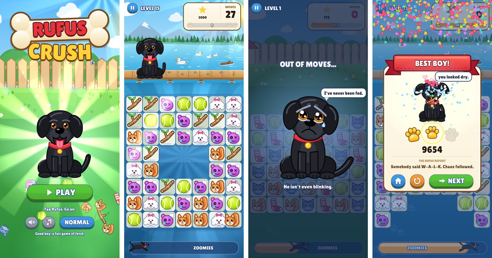

# Phone games

Made by Claude Fable 5.2, instigated by [Brandon Hoult](https://hoult.co).

Small games made for a phone. Each one lives in its own folder, builds to a
handful of static files, and plays with no connection.

| Game | What it is |
| --- | --- |
| [Rufus Crush](rufus-crush/) | A match-3 about the very busy life of one black lab. Rust and WebGL, 36 levels, Easy / Normal / Hard. |

## Licence

MIT: see [LICENSE](LICENSE). Fonts bundled with a game keep their own licence,
which sits next to the font file.
