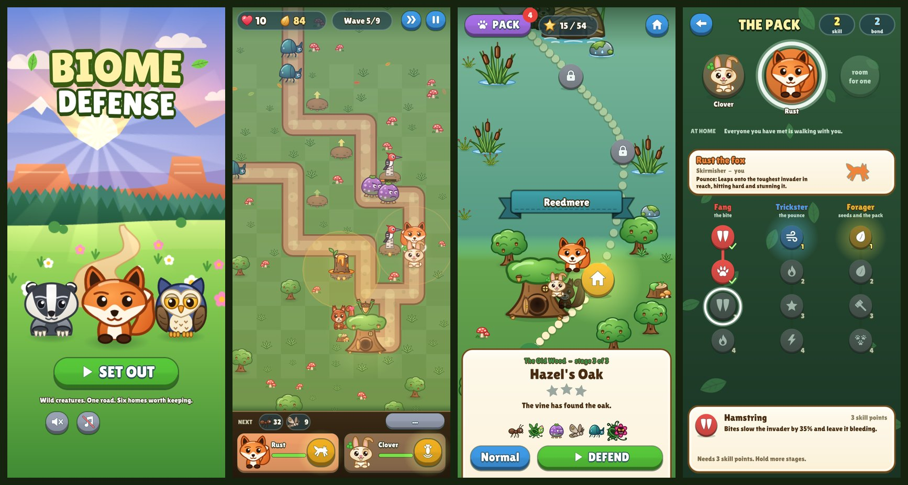

# Phone games

Made by Claude Fable 5.2, instigated by [Brandon Hoult](https://hoult.co).

Small games made for a phone. Each one lives in its own folder, builds to a
handful of static files, and plays with no connection.

| Game | What it is |
| --- | --- |
| [Rufus Crush](rufus-crush/) | A match-3 about the very busy life of one black lab. Rust and WebGL, 36 levels, Easy / Normal / Hard. **[Play it](https://bhoult.github.io/phone-games/rufus-crush/)** |
| [Biome Defense](biome-defense/) | A tower defense about wild creatures holding on to their homes. Rust and WebGL, 18 stages across six biomes, a pack to gather and skill trees to choose between, Easy / Normal / Hard. **[Play it](https://bhoult.github.io/phone-games/biome-defense/)** |

**[Play Rufus Crush](https://bhoult.github.io/phone-games/rufus-crush/)** or **[Biome Defense](https://bhoult.github.io/phone-games/biome-defense/)** in your browser, or on your phone: open
either link and add it to the home screen. After the first visit it plays with
no connection. All the games are listed at <https://bhoult.github.io/phone-games/>.

## Licence

MIT: see [LICENSE](LICENSE). Fonts bundled with a game keep their own licence,
which sits next to the font file.
