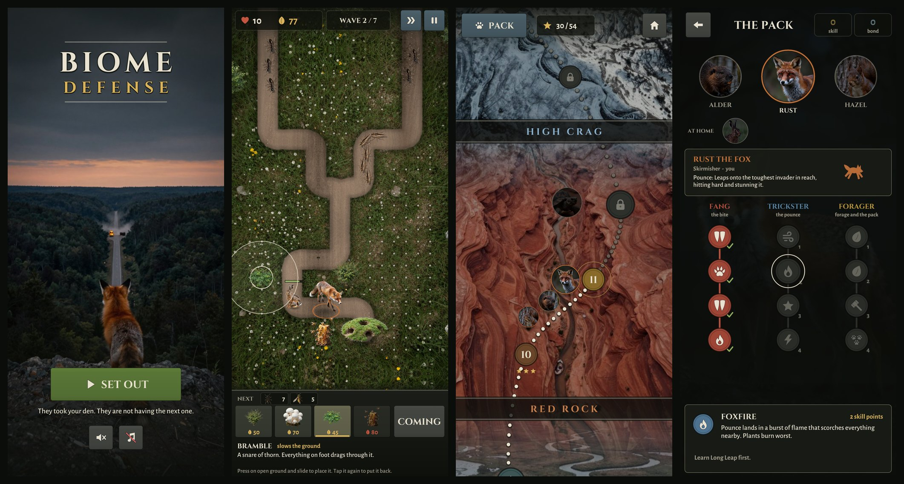

# Biome Defense

Made by Claude Fable 5.2, instigated by [Brandon Hoult](https://hoult.co).

**[Play it in your browser](https://bhoult.github.io/phone-games/biome-defense/)**, or on your phone: open that link and
add it to the home screen. After the first visit it plays with no connection.

[](https://bhoult.github.io/phone-games/biome-defense/)

A tower defense for phones about wild creatures holding on to their homes.
You are a fox, a badger or an owl whose den went under a bulldozer last
spring. Now the ground is moving again: swarms first, then vines that grow in
cut earth, then people with orange stakes. Cross six biomes, stand with
whoever lives in each one, and find out what is coming west behind them.

It is meant for adults: the pictures are photographic, the telling is spare,
and structures go wherever you judge best, not on marked spots.

Written in Rust, drawn with WebGL, compiled to one WebAssembly file. Everything
(pictures, fonts, sound) is inside the build: it makes no network requests and
runs offline.

## Play it

Online: <https://bhoult.github.io/phone-games/biome-defense/>

From a copy of this repository:

```
./build.sh serve
```

then open the address it prints (<http://localhost:8080>, or the next free port if that one is taken). Needs Rust with the `wasm32-unknown-unknown`
target (the script adds the target if it's missing) and Python 3 for the little
web server.

- **Build anywhere.** Tap a structure in the tray, then press on open ground
  and slide: it floats above your finger with its reach drawn round it, and is
  built where you let go. A quick tap builds right there. Pale dots mark ground
  that will take it; the trail, water, rocks and trees, the home and other
  structures are in the way, and it says which. Or drag it straight out of the
  tray. Tap the tray again to put it back.
- **Tap a structure** to improve or sell it. Improving makes each hit heavier,
  which is what gets through armor, and the third level adds something new;
  building again watches more trail. Neither is simply better, but a stand-in
  that only ever builds more does worse than one that also improves what it
  has (`balance carpet` prints the comparison). Every biome has its own: shrikes and wild hives
  in the meadow, bullfrogs and eels in the marsh, rattlesnakes in the desert,
  eagles on the crag.
- **Tap the ground** to send your creature there. Fighters hold invaders where
  they stand; the owl and the other watchers strike from where nothing can
  reach them.
- **Tap the square button** on a creature's card to use its ability: a pounce,
  a ground slam, a gust that blows the trail clear.
- **START** brings the first wave. After that they come by themselves; calling
  one early pays a little forage.
- Invaders that reach the home wear it down. Keep nine parts in ten for three
  marks.
- Fliers go over fighters and are only hit by things that reach the air.
  Armor shrugs off light hits. Things on wheels cannot be held. The strip
  above the tray shows who is coming next: tap one to read about it.

**The pack.** Hold the last stage of a biome and whoever lives there offers to
come with you: Sorrel the hare, Hazel the squirrel, Alder the beaver, Mesa
the tortoise, Tarn the marmot. Two can walk with you at a time. The others
wait at home, and fight for it when you pass through.

**Skills.** Every stage held for the first time earns one skill point and one
bond point. Your own creature spends skill points on its three branches. Each
skill costs one more than the one before it, and there are 18 points in the
whole game against 30 to learn everything, so reaching the end of a branch
means going without elsewhere, and what you choose is for keeps. Followers
learn with bond points, shared between them; a follower who goes home hands
theirs back for whoever walks with you next. All of it is under **PACK** on
the map.

**Difficulty** is a button on each stage's card: Easy, Normal or Hard. It
changes how tough invaders are and how much the home can take; the stages
and the points are the same. Lose a stage and the card offers to drop down a
setting with one tap.

Progress is saved on the device.

## Putting it on a phone

Open <https://bhoult.github.io/phone-games/biome-defense/> on the phone and
choose "Add to Home screen" (Android Chrome: the menu; iPhone Safari: the share
button). A service worker caches all nine files of the game on the first visit,
so from then on it starts from the home screen and plays with no connection.

`./build.sh` leaves the whole game in `dist/` as nine static files that can go
on any web host. One catch: browsers only allow the offline caching on
**https** or **localhost**.

The copy at the link above is `docs/biome-defense` at the top of this
repository, served by GitHub Pages. `./build.sh pages` rebuilds it; commit and
push to publish.

There is no Android app for this one yet (Rufus Crush next door has one; the
same wrapper would fit).

## How it's put together

```
core/     the rules. Pure Rust, no dependencies, no rendering.
  src/sim.rs        a stage being played, in fixed ticks: invaders, structures, the pack
  src/map.rs        the ground: the trail, and where a structure can stand
  src/defs.rs       the invaders, the structures and the biomes, as data
  src/creature.rs   the eight creatures, their abilities and skill trees
  src/level.rs      the 18 stages: maps, who comes, and the wave generator
  src/campaign.rs   the journey: marks, points, who is in the pack, the save format
  src/bot.rs        a stand-in player for testing and tuning
  tests/rules.rs    rule tests, whole stages, a random-tapping player
  examples/balance.rs   reports on, and sets, how hard the stages are
game/     everything you see and hear (macroquad -> WebGL).
  src/play.rs       a stage: steps the rules and shows what they report
  src/field.rs      the ground of a stage
  src/gfx.rs        sprites, text, and the shader that works the trail into the ground
  src/map.rs        the trail through the biomes
  src/pack.rs       the pack and the skill trees
  src/story.rs      the story, and who joins or stays behind
  src/content.rs    the words
  src/synth.rs      every sound and both tunes, synthesised at startup
  assets/img/       the photographs: cut-outs, ground, whole pictures
  assets/svg/       the interface and effects, as SVG
  build.rs          packs the cut-outs and SVGs into one texture, and three
                    fonts into a texture of glyphs, at build time
web/      index.html, the JS bridge, service worker, manifest
tools/    test driver, picture generation, contact sheets, balance tuning
art/      raw pictures and working files (not kept in git)
```

The rules never animate anything. They advance in ticks of a sixtieth of a
second and report what happened (a structure fired, an invader was stopped, a
dam went up); the game layer turns that into pictures and sound and draws
positions in between ticks. That split is what lets whole stages be played
natively thousands of times a second, which is how they are tested and how
their difficulty is set.

## Changing things

**Stages** are in `core/src/level.rs`: a name, a tip, the map drawn as 13 rows
of 9 characters (`.` open ground, `#` trail, `A` `B` where invaders come in,
`H` the home, `~` water, `T` something tall, `r` a rock), who comes and from
which wave, how many waves, and `plots`: how many structures the stage's income
is sized around. The waves themselves are generated from those. After changing
a stage, or anything about structures, invaders or creatures, run

```
tools/apply_tune.py
```

It plays every stage with the stand-in player, sizes each wave to a share of
the most the stand-in can stop, sizes each boss the same way, and writes the
numbers back into the file. It takes under a minute.
`cargo run -p biome-core --release --example balance` prints how the stand-in
then does on Easy, Normal and Hard with each starting creature (`balance
waves` lists who comes when, `balance why 8 hard` says who got through).

**Difficulty** is one table: `CURVE` at the top of `core/examples/balance.rs`.
For each biome it gives the pressure of a wave at the start of a stage and at
the end of it, on Normal, as a share of the stand-in's limit. Raise a number to
make that stretch harder, then run `tools/apply_tune.py` again. Easy and Hard
are fixed steps either side (`Difficulty::toughness` in `core/src/level.rs`).
The numbers describe a stand-in player, not a person. It builds only as many
structures as a stage is sized for, on sensible ground picked from a coarse
grid, and never sells: someone who places well should beat it. If the game
feels wrong to you, move the numbers.

**Structures, invaders and creatures** are tables in `core/src/defs.rs` and
`core/src/creature.rs`. A skill is a name, a sentence and a list of effects.

**Pictures.** Every photograph in the game was generated on a desktop GPU with
[Z-Image-Turbo](https://huggingface.co/Tongyi-MAI/Z-Image-Turbo), from the
prompts in `tools/art_list.py`: one entry per picture, with its seed, so any
of them can be made again or changed. What the game is built from is in
`game/assets/img/` and is kept in git, so building needs no GPU and no Python.
To change a picture:

```
python3 tools/paint.py fox                       # make it again (edit its prompt or seed first)
art/.venv/bin/python tools/cut.py fox            # cut it out, size it, put it in the game
tools/sheet_raw.py out.jpg --cut fox badger      # look at the result
```

`paint.py` needs a Python with `torch` and `diffusers` and the model in the
Hugging Face cache; a 1024 x 1024 picture takes about a quarter of a minute on
a 16 GB card. `cut.py` needs `rembg`, `pillow` and `numpy`
(`uv venv art/.venv && uv pip install "rembg[cpu]" pillow numpy`). Animals and
people are photographed from 45 degrees up, facing right, and mirrored to face
their heading; insects, machines and anything that flies are photographed from
straight above and turned (`rot` in the list is what it took to point each one
right). A different look, painted or drawn, is a matter of changing the
style words at the top of `art_list.py` and running both tools again.

**The interface and effects** are SVG in `game/assets/svg/`. Edit a file and
rebuild. `tools/preview.py out.png game/assets/svg/atlas/ui` renders a contact
sheet straight from the files; `tools/sheet.py out.png` renders one of the
whole built atlas.

**The story** is in `game/src/content.rs`. The fonts are baked into the build
as plain ASCII (anything else shows as a question mark), so keep to it.

## Testing

```
cargo test -p biome-core --release
```

runs the rule tests: every map is playable, structures go anywhere open and
nowhere else, every skill does something, points always add up whatever is
learned, swapped or sent home, doing nothing loses every stage, the stand-in
wins every stage on Easy and Normal, and a player who builds, sells and orders
at random for six minutes never breaks anything. `cargo test -p
biome-defense` checks every sound is audible and unclipped.

`tools/drive.mjs` drives a real build in headless Chrome at phone size, with
real touch events:

```
node tools/drive.mjs "http://localhost:8080/?debug=1&hero=fox&level=1" shots \
    wait:2500 dragto:build0,0 tapbtn:build1 tapspot:1 tapbtn:call waitfor:"WAVE 2" shot:after
```

The page takes a few switches in its address for this. A session that fakes
progress or settings (`hero`, `unlock`, `fresh`, `mute`, `difficulty`) never
writes to saved data:

| switch | effect |
| --- | --- |
| `level=7` | start in that stage |
| `screen=map` | start on the map (`pack`, `choose`) |
| `hero=owl` | play as the owl (`fox`, `badger`) |
| `unlock=9` | as if the first nine stages were behind you |
| `story=1` | with `unlock`: tell the story from there, rather than skip it |
| `fresh=1` | ignore the saved journey for this session |
| `auto=1` | the stand-in plays (`auto=2` also moves on when a stage ends) |
| `speed=3` | run time faster |
| `seed=42` | same dice every time |
| `debug=1` | narrate to the console, and report where buttons, building ground and structures are |
| `mute=1` | start silent |
| `difficulty=0` | Easy (`1` Normal, `2` Hard) |

## Updating a copy that is already installed

Reload it, wait a few seconds, and reload it again (on a phone, close it and
open it twice). The first reload fetches the new build in the background while
still showing the old one; the second one runs it. Progress is kept.

## Credits

- Fonts: [Cinzel](https://fonts.google.com/specimen/Cinzel) by Natanael Gama
  and [Alegreya Sans](https://fonts.google.com/specimen/Alegreya+Sans) by Juan
  Pablo del Peral (Huerta Tipografica), both under the SIL Open Font License
  (`game/assets/font/OFL-*.txt`).
- Pictures: generated with
  [Z-Image-Turbo](https://huggingface.co/Tongyi-MAI/Z-Image-Turbo) (Apache-2.0)
  and cut out with [rembg](https://github.com/danielgatis/rembg) (MIT) and
  BiRefNet. None of them is a photograph of a real animal, person or place.
- Engine: [macroquad](https://macroquad.rs) (MIT / Apache-2.0).

The game's own code, pictures and interface art are under the MIT licence: see
`LICENSE` at the top of this repository.
