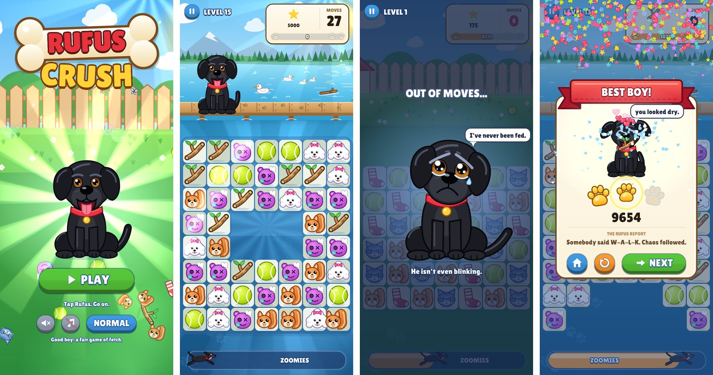

# Rufus Crush

Made by Claude Fable 5.2, instigated by [Brandon Hoult](https://hoult.co).

**[Play it in your browser](https://bhoult.github.io/phone-games/rufus-crush/)**, or on your phone: open that link and
add it to the home screen. After the first visit it plays with no connection.

[](https://bhoult.github.io/phone-games/rufus-crush/)

A match-3 for phones about the very busy life of one black lab. Line up tennis
balls, squirrels, cats, stolen socks, poodles, squeaky toys and sticks across
1,036 levels. The first 36 are Rufus's first day, drawn by hand: the backyard,
the dog park, the lake, mud season, delivery day and night patrol. Then he
wakes up and does it all again, for 28 more days and 1,000 more levels, each
day somewhere new: the creek, the farmers' market, the forbidden couch.

Written in Rust, drawn with WebGL, compiled to one WebAssembly file. Everything
(art, font, sound) is inside the build: it makes no network requests and runs
offline.

## Play it

Online: <https://bhoult.github.io/phone-games/rufus-crush/>

From a copy of this repository:

```
./build.sh serve
```

then open <http://localhost:8080>. Needs Rust with the `wasm32-unknown-unknown`
target (the script adds the target if it's missing) and Python 3 for the little
web server.

- **Swipe** a piece onto its neighbour (or tap one, then the other) to line up 3.
- **4 in a line** makes a *Zoomies* piece: Rufus tears down the row or column.
- **An L or a T** makes a *Big Woof*: flattens everything nearby.
- **5 in a line** makes *Golden Rufus*: swap him with anything and he fetches
  every one of them on the board.
- Swap two of those onto each other for something bigger.
- Matching fills the **zoomies meter**. When it's full, tap it (or tap Rufus) for
  three free laps of the board. It costs no move, and if you run out of moves
  with a full meter you get to use it before the level ends.
- Leftover moves at the end turn into a treat frenzy.
- Run out of moves when the level is nearly done and Rufus gives you **the
  look**. Nobody can say no to the look: it is worth 3 more moves, once per
  attempt.
- At the lake he swims his zoomies instead of running them, and shakes off
  when he gets out. You will be standing next to him.

**Difficulty** is a button on the title screen and the pause card: Easy,
Normal or Hard. It only changes how many moves each level gives you; the
boards and goals are the same. It can be changed at any time and applies from
the next level you start. Lose a level and the card offers to drop down a
setting with one tap. On every setting the first chapter is gentle and later
chapters ask more.

Each level is rated one to three paws. Progress is saved on the device.

**Rufus's story.** Rufus is a real dog, and the game tells how he got here: a
scrapbook that opens a page after the first level and another at the end of
each chapter, 23 pages in all. New pages turn up on the way to the next
level; the book so far can be read again from the title screen.

After the first day the game does not keep getting harder: every later
chapter opens gently and closes about as hard as Night Patrol does, on
whichever setting you picked.

## Putting it on a phone

### Any phone: the web page (easiest)

Open <https://bhoult.github.io/phone-games/rufus-crush/> on the phone and choose "Add to Home screen" (Android Chrome:
the menu; iPhone Safari: the share button). A service worker caches all nine
files of the game on the first visit, so from then on it starts from the home
screen and plays with no connection. Progress is kept on the phone.

### Android: the app

```
android/build.sh install
```

builds `android/rufus-crush.apk` and installs it on whatever phone `adb` can see
(USB or wireless debugging). The app is the web build packed into an APK and
shown in a WebView. It holds no internet permission at all, so it is offline by
construction. Without `install` it only builds the APK, which you can copy to
the phone and open.

Needs the Android SDK (`ANDROID_HOME`, default `~/Android/Sdk`) and a JDK 17+
(`JAVA_HOME`).

### Hosting it yourself

`./build.sh` leaves the whole game in `dist/` as nine static files that can go
on any web host. One catch: browsers only allow the offline caching on
**https** or **localhost**. Opening `http://192.168.x.x:8080` over wifi plays
fine but will not install for offline use.

The copy at the link above is `docs/rufus-crush` at the top of this
repository, served by GitHub Pages. `./build.sh pages` rebuilds it; commit and
push to publish.

## How it's put together

```
core/     the rules. Pure Rust, no dependencies, no rendering.
  src/board.rs    matching, power pieces, gravity, shuffles
  src/level.rs    goals, paw ratings, and the 36 hand-made levels
  src/later.rs    the other 1,000 levels (written by examples/mklevels.rs)
  src/chapters.rs the 173 chapters: their names and where each one happens
  src/bot.rs      a stand-in player for testing and tuning
  src/tune.rs     works out move budgets from how the stand-in gets on
  examples/       mklevels (designs levels), balance (reports and retunes)
  tests/rules.rs  rule tests and fuzzers
game/     everything you see and hear (macroquad -> WebGL).
  src/play.rs     the level screen: plays back what the rules report
  src/rufus.rs    Rufus, assembled from parts so he can wag, bark and sulk
  src/synth.rs    every sound, synthesised at startup
  src/content.rs  the jokes
  src/story.rs    the scrapbook: Rufus's story, its pages and its screen
  src/ambient.rs  clouds, butterflies, rain, fireflies: what moves in the backdrops
  src/gfx.rs      sprite drawing, plus the two shaders (added light, and the gleam)
  assets/svg/     all the art, as SVG
  build.rs        rasterises the SVGs into a texture atlas at build time
web/      index.html, the JS bridge, service worker, manifest
android/  the WebView shell
tools/    test driver, contact sheets, balance tuning
```

The rules engine never animates anything. It resolves a whole step at once and
returns a report of what happened and when (which pieces popped, what fell
where); the game layer plays that report back and asks for the next step. That
split is what lets the rules be tested natively at thousands of games a second.

## Changing things

**The first 36 levels** are in `core/src/level.rs`: a title, a one-line tip,
the goals, and the board drawn as nine rows of characters (`.` piece, `m`/`M`
mud, `b`/`B` box, `o` bone, space for no tile). After changing a level's goals
or layout, run

```
tools/apply_tune.py
```

It plays every level a few hundred times with the stand-in player and writes the
move budget and paw thresholds back into the level data, so levels stay
winnable. `cargo run -p rufus-core --release --example balance` prints the win
rates, measured on different boards from the ones the tuner used, with a
summary of all 1,036 at the end.

**The other 1,000** were not drawn by hand. `core/examples/mklevels.rs` is a
level designer: for each level it picks what the level is about from its
chapter's place (bones at the park, sticks and ponds by the water, mud,
parcels indoors, a bit of everything at night), draws a board, then plays it a
few hundred times. It scales the goals until the level takes about as many
moves as it should, and throws the design away and draws another if it plays
badly: needing reshuffles, swinging wildly from one game to the next, or with
a goal that is only decoration. What survives is written to
`core/src/later.rs` as ordinary level data, in the same form as the hand-made
levels. The game itself never runs the designer.

```
cargo run -p rufus-core --release --example mklevels
```

redoes all of them (about ten minutes on a desktop). Do that after changing
the designer: its menus of what each place serves, its board shapes, its word
lists for titles. Chapter names are in `core/src/chapters.rs`.

**Difficulty** is one table: `CURVES` at the top of `core/src/tune.rs`. It has
a row for Easy, Normal and Hard, and in each row a pair of numbers per chapter
of the first day: the chance that a casual player wins a level on one attempt
at the start of the chapter, and at the end of it. Every chapter after the
first day uses the last pair. Raise a number to make that stretch easier or
lower it to make it harder, then run `tools/apply_tune.py` again; it rewrites
all three move budgets for every level, hand-made or not. The numbers describe
a stand-in player, not a person, so if a setting feels wrong to you, move its
whole row.

**Art** is SVG in `game/assets/svg/`. Edit a file and rebuild; `tools/sheet.py
out.png` renders a contact sheet of the atlas to look at. Rufus's parts share
one coordinate space (300 x 330), and each part's `viewBox` says where it sits.

**Jokes** are in `game/src/content.rs`.

**The story** is the `PAGES` table in `game/src/story.rs`: a title and a few
lines for each page, and how its picture is staged (which backdrop, in what
light, Rufus's mood, and any props, which are the sprites in
`game/assets/svg/atlas/story/`). `PAGE_EVERY` in the same file is how many
levels there are between pages. Which pages a player has opened is worked out
from the levels they have finished, so changing the spacing never loses
anybody's place.

## Testing

```
cargo test -p rufus-core --release
```

runs the rule tests, including fuzzers that play thousands of random games and
check after every step that the board is legal and that the reports are enough
to rebuild it.

`tools/drive.mjs` drives a real build in headless Chrome at phone size, with
real touch events:

```
node tools/drive.mjs "http://localhost:8080/?level=1&debug=1" shots \
    wait:2500 tap:195,560 wait:1500 swipehint wait:2500 expect:"SWAP ok" shot:after
```

The page takes a few switches in its address for this. A session that fakes
progress or settings (`unlock`, `mute`, `difficulty`) never writes to saved data:

| switch | effect |
| --- | --- |
| `level=7` | start in that level |
| `screen=map` | start on the map |
| `screen=story` | start in Rufus's scrapbook (with `unlock=1`, every page) |
| `auto=1` | the game plays itself (`auto=2` also moves on to the next level) |
| `speed=3` | run time faster |
| `seed=42` | same board every time |
| `moves=5` | override the move budget |
| `unlock=1` | all levels open |
| `debug=1` | narrate state changes to the console |
| `mute=1` | start silent |
| `difficulty=0` | Easy (`1` Normal, `2` Hard), for this session only |

`tools/dump_audio.sh` renders every sound to a WAV file.

## Updating a copy that is already installed

The web page, or the copy on your home screen: reload it, wait a few seconds,
and reload it again (on a phone, close it and open it twice). The first
reload fetches the new build in the background while still showing the old
one; the second one runs it. Progress is kept. The Android app: run
`android/build.sh install` again.

## Credits

- Font: [Lilita One](https://fonts.google.com/specimen/Lilita+One) by Juan
  Montoreano, SIL Open Font License (`game/assets/font/OFL.txt`).
- Engine: [macroquad](https://macroquad.rs) (MIT / Apache-2.0).
- Starring Rufus, who is a very good boy.

The game's own code and art are under the MIT licence: see `LICENSE` at the top
of this repository.
